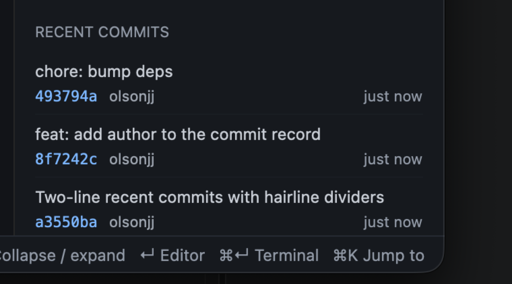
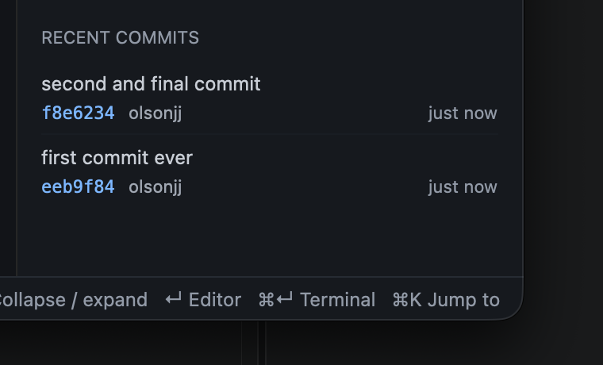

## Summary

The details pane's RECENT COMMITS list becomes two lines per commit: the subject alone on line one, and the metadata (`hash · author · time`) on line two in the quiet tier, with a hairline divider between rows. Ticket 26 carried the author through the core read; ticket 27 places it on screen.

```diff
 (commit, i)                      # id + unit preserved (tests, VoiceOver)
-  493794a  chore: bump deps  just now
+  chore: bump deps             # truncates on its line only
+  493794a  olsonjj     just now  # author is the flexible, truncating piece
+  ────────────────────────────  # commit_divider, none after the last row
```

The read gains one field end to end:

```text
recent_commits                       # --format gains %an (author, not committer)
  parse_log                          # splitn(3) → splitn(4)
    Commit.author                    # absent/empty degrades to "", never fails
DetailsView.commit_row
  subject line                       # unchanged size/color, truncate
  metadata line                      # hash (link, mono) · author (muted) · time (faint)
```

Empty author absorbs the gap (no dangling separator, time stays put); inter-row spacing is the rows' inner padding, so the divider is symmetric and owned by the row.

## Evidence

- **Before:** one cramped line per commit — title ellipsized first, no author anywhere.
- **After:** same gate green (`just check`: fmt, clippy, all tests, docs). New/extended tests:

```text
git::tests::parses_log_with_special_characters     # populated author, empty/absent slot
details::recent_commits_carry_the_author_name      # real repo: author "olsonjj",
                                                   # committer "T" asserted distinct
main_window::tests::details_list_last_five_commits_in_background
                                                   # each row's unit names the author
                                                   # and relative time, ids preserved;
                                                   # five-rows + error guards unchanged
```

Built app (build 15), 4-commit repo:



2-commit repo, bottom of the list — divider between rows, none after the last:



## Merge Danger

**Door:** two-way

One struct field threaded through an existing read seam, plus view layout. A revert restores the single-line rows exactly; the format string and parser change together or not at all.

**Blast Radius:** pane-local

The only user-visible change is the RECENT COMMITS block of the details pane. The read path (per selection, keyed on HEAD), the count of five, row ids, and the loading/error/empty states are untouched. Theme gains one color token used by nothing else.